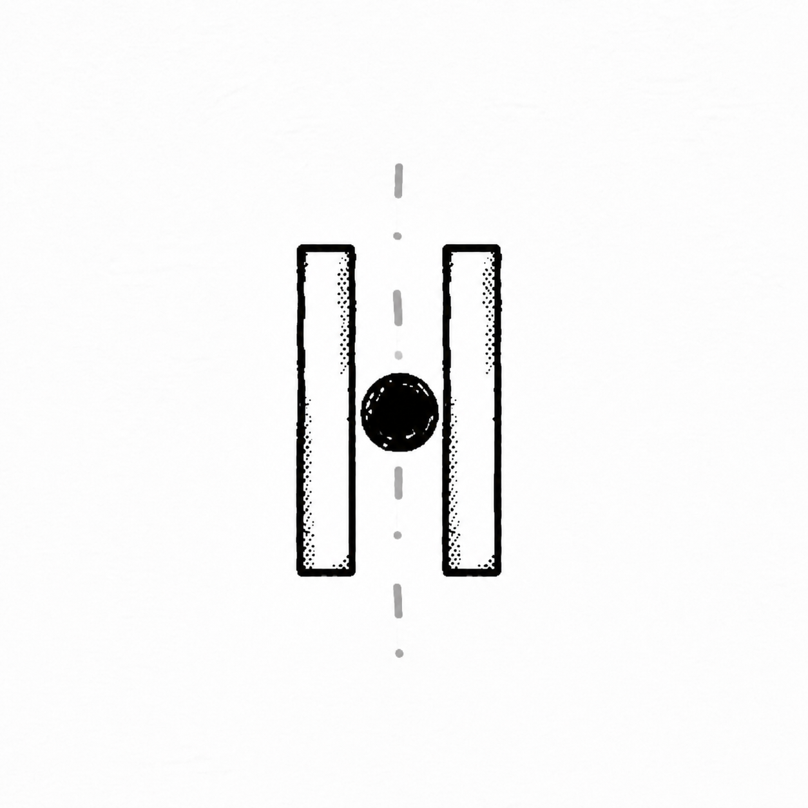

<div align="center">



# Paddle Polygon

**Online Pong for 2 to 10 friends: one paddle per side, a court that shrinks as players are knocked out, and a one-dimensional finale.**

[](https://gr33nops.github.io/pong/)
[](https://github.com/Gr33nOps/pong/releases/latest)
[](https://godotengine.org/)

[Play now](https://gr33nops.github.io/pong/) · [Download](https://github.com/Gr33nOps/pong/releases/latest) · [Report a problem](https://github.com/Gr33nOps/pong/issues)

</div>

## The game

Everyone in the room defends one side of a regular polygon: three friends play on a triangle, ten on a decagon. Let the ball past your side once and you are out: your side folds away, the court shrinks to the next shape down, and you watch the rest of the match.

When only two players are left, the court collapses into a single line for a **1D Pong** finale. The ball runs back and forth along it, and you press Space while it is inside your hatched hit zone. The later you hit, the faster it flies back; swing too early and you are locked out for a moment. Whoever misses first loses, and the last player standing wins.

Your own side is always drawn at the bottom of the screen, and every side shows its player's name.

## Play with friends

1. Press **PLAY** and type your name.
2. **CREATE ROOM**, then press **INVITE FRIENDS** to copy a link (or **COPY CODE** for the six-character code) and send it to your friends.
3. Friends open the link, or press **JOIN ROOM** and type the code. The court grows one side for each person who joins, up to ten.
4. When everyone is in, the host presses **START MATCH**. After the match everyone goes back to the room for another round.

If someone leaves during a match they are knocked out and the rest play on. The hosted server may need a short wake-up after being idle.

## Controls

| Action | Keyboard | Controller |
|---|---|---|
| Move your paddle | ← / → or A / D | Left stick or D-pad |
| Swing (line finale) | Space, ↑ or W | A |
| Move in menus | ↑ / ↓ | D-pad up / down |
| Select | Space or Enter | A |
| Menu / back | Esc | Start / Back / B |
| Mute | M | — |
## How online stays smooth

The server runs every match. Each browser draws the ball one round trip ahead of the latest update, which is when its own paddle input reaches the server. It replays your own recent paddle movement when predicting returns, and corrections glide rather than jump. In the line finale, a swing is judged against where the ball was when you pressed, so a little network delay doesn't cost you the hit.

## Download

The [latest release](https://github.com/Gr33nOps/pong/releases/latest) includes:

- Windows x64 archive
- Browser-ready Web archive for hosts such as itch.io
- SHA-256 checksums for every download

Windows builds are currently unsigned, so SmartScreen may show an unknown-publisher warning.

## Run from source

Requires Godot 4.7.1.

1. Clone the repository.
2. Open the directory containing `project.godot` in Godot.
3. Press **F5**.

The game connects to the hosted server. To play against your own server instead, start it (`godot --headless --path server --scene server_main.tscn`, port 9080) and set `PONG_SERVER_URL=ws://127.0.0.1:9080` before launching the game. Open two or more copies of the game to fill a room.

Run the deterministic client checks:

```bash
godot --headless --path . --script tests/arena_smoke.gd
godot --headless --path server --script res://arena_room_smoke.gd
```

The online check needs a local server running on port 9081 (`PORT=9081 godot --headless --path server --scene server_main.tscn`):

```bash
godot --headless --path . --script tests/arena_online_smoke.gd
```

## Build

Export presets are committed for Windows and Web. Builds go into `build/`, which git ignores:

```bash
godot --headless --path . --export-release "Windows Desktop" build/windows/paddle-polygon.exe
godot --headless --path . --export-release "Web" build/web/index.html
```

Every push to `main` validates the simulation, the scene, room flow, and a real online match (including a swing in the line finale) before deploying GitHub Pages. A `v*` tag builds and publishes the downloadable release artifacts.

## Project map

```text
assets/              art, sounds, the font and the ink UI theme
scenes/arena.tscn    the game's only scene
scripts/
  arena.gd             game flow: menus, rooms, invites, input
  arena_simulation.gd  the rules: court, paddles, knockouts, shrinking, line finale
  court_view.gd        draws the court, paddles, ball and player names
  court_lines.gd       draws the ink lines of the court
  menu_overlay.gd      the paper menus
  online_view.gd       hides network delay in online matches
  autoload/            always-loaded helpers: Network, Sound, Settings, InkEffects
  ui/                  ink-style buttons and panels
server/              the online server (its own Godot project)
tests/               automated checks
web/web_shell.html   the web page around the game (loading screen)
```

`server/arena_simulation.gd` is a copy of `scripts/arena_simulation.gd`, so the server and the game play by exactly the same rules. If you change one, copy it over the other; the tests fail if they differ.

Contributions are welcome. See [CONTRIBUTING.md](CONTRIBUTING.md) and [SECURITY.md](SECURITY.md).
